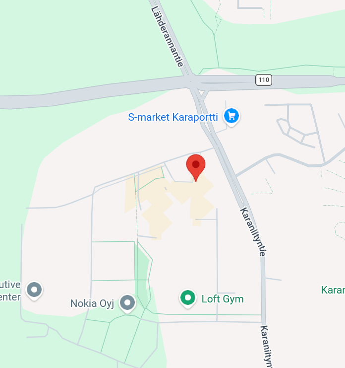

# Sailagit.github.io

[style.css](https://github.com/user-attachments/files/34241891/style.css)

html {
    font-family: Verdana, Geneva, Tahoma, sans-serif;
}

body {
    margin: 0;
}

header {
    background-color: cadetblue;
    padding: 0;
}

.box {
    display: flex;
    flex-direction: row;
    justify-content: space-between;
    align-items: center;
    gap: 400px;
    background-color:cornflowerblue
}

nav {
    float: right;
}

#logo {
    background-color: blueviolet;
    color:goldenrod;
    width: 10%;
    float: left;
    font-size: 3em;
    height: 6rem;
    display:block;
    text-align: center;
    line-height: 6rem;
    font-family:'Franklin Gothic Medium', 'Arial Narrow', Arial, sans-serif;
    font-weight: bolder;
    letter-spacing: 2px;
}

ul {
    display: flex; 
    list-style-type: none;
    padding: 0;
    margin: 0;
}

li {
    width: calc(100% / 3);
}

li a{
    color: floralwhite;
    width: 100%;
    height: 6rem;
    display: block;
    text-align: center;
    line-height: 6rem;
    text-decoration: none;
    justify-content:right;
    letter-spacing: 2px;
}

li a:hover {
    background-color: hwb(240 0% 75%);
}

main {
    background-color: #9c9cac;
    padding: 1rem;
    display: flex;
    flex-wrap: wrap;
    justify-content: center;
}

.mainpage {
    width: 100%;
    display: flex;
    flex-direction: column;
    flex-wrap: wrap;
}

h1 {
    text-align: center;
    width: 100%;
    font-size: 50px;
}

.fit-picture1 {
    width: 100%;
    max-width: 1000px;
    margin: auto;
}

article {
    width: 50% ;
    padding: 1rem;
    box-sizing: border-box;
    text-align: center;
}

.kolme_kuvaa {
    display: flex;
    flex-direction: row;
    justify-content: center;
    gap: 1rem;
    width: 100%;
}

.tuote {
    background-color: gainsboro;
    width: calc(100% / 3);
    padding: 1rem;
    box-sizing: border-box;
}

.fit-picture2 {
    width: 500px;
    height:600px;

}

figure {
    margin: 0;
}

img {
    border-radius: 8px;
}

figcaption {
    padding-top: 1rem;
}

.contact {
    display: flex;
    flex-direction: row;
    justify-content: space-between;
    width: 100%;
    padding: 2rem;
    box-sizing: border-box;
}

.info {
    width: 0;
}

.info h1 {
    text-align: left;
    font-size: 30px;
}

.info address {
    margin-top: 2rem;
}

.map {
    width: 60%;
    height: 300px;
    background-color: #333;

}

aside {
    background-color: gainsboro;
    width: 100%;
}

input {
    display: block;
    width: 100%;
    padding: 1rem;
}

@media screen and (min-width: 769px) {
    .container {
        width: 100%;
    }

    section {
        width: 100%;
    }

    aside {
        width: 100%;
    }

    article {
        width: 100%;
    }

    li {
        width: 10rem;
    }

    .tuote {
        width: 100%;
    }
    
}
[verkkosivu.html](https://github.com/user-attachments/files/34241895/verkkosivu.html)
<!DOCTYPE html>
<html lang="fi">
  <head>
    <meta charset="UTF-8" />
    <title>Tulokset</title>
    <meta name="viewport" content="width=device-width, initial-scale=1">
    <link href="style.css" rel="stylesheet">
  </head>
  <body>
    <header>
        

            
KaraL

            <nav>
                <ul>
                    <li><a href="#koti">Koti</a></li>
                    <li><a href="#menu">Menu</a></li>
                    <li><a href="#yhteystiedot">Yhteystiedot</a></li>
                </ul>
            </nav>
    </header>
        <main>
            <section class="mainpage">
                

                <h1>Karalounas</h1>
            <article class="etusivu">
                <figure>
                    
                </figure>
                <figcaption>Lorem ipsum dolor sit amet consectetur adipisicing elit. Optio qui maiores laudantium, libero dolorem tenetur corporis earum dicta molestias eum dolores saepe non aut quae aliquid accusamus ad nam eaque.
                    Lorem ipsum dolor sit amet, consectetur adipisicing elit. Officia quam debitis maxime magnam doloribus praesentium vero, minus, cupiditate nihil dolorem exercitationem amet. Sint veritatis enim doloribus aliquid eveniet dolor quod.
                    Lorem ipsum dolor sit amet consectetur adipisicing elit. Eius adipisci, sit possimus maxime magnam vel ducimus est deserunt dignissimos tenetur quod architecto quia et. Officia veniam repudiandae nesciunt dolor corrupti.
                </figcaption>
            </article>
            

            

                <article class="tuote">
                    <h3>Vegaaninen kasvilounas</h3>
                    <figure>
                        
                        <figcaption>Bataatti kookoscurry</figcaption>
                    </figure>
                    
Lorem ipsum dolor sit amet consectetur adipisicing elit. Illum quos, nemo placeat rem corrupti velit expedita blanditiis laborum cum tenetur excepturi optio labore, deleniti voluptates consectetur, omnis beatae? Accusamus, voluptatum.

                    
Lorem ipsum dolor sit amet, consectetur adipisicing elit. Repudiandae amet, cum itaque qui deleniti, consequatur explicabo nam quibusdam in illo est ad accusamus labore, quam aut voluptas alias sapiente illum?

                </article>
                <article class="tuote">
                    <h3>Lihalounas</h3>
                    <figure>
                        
                        <figcaption>Savupekonipasta</figcaption>
                    </figure>
                    
Lorem ipsum dolor sit amet consectetur, adipisicing elit. Fugit numquam ducimus dicta sint esse cupiditate odit voluptatibus, aut quam deserunt ea consectetur accusamus? Veritatis, libero. At atque eveniet id quos.

                    
Lorem ipsum dolor sit amet consectetur adipisicing elit. Animi at quaerat sapiente veniam illo odio nesciunt doloribus eos nostrum quam quod, illum et enim fugit similique adipisci labore esse magni.

                </article>
                <article class="tuote">
                    <h3>Kalalounas</h3>
                    <figure>
                        
                        <figcaption>Kalapyörykät ja tillikastike</figcaption>
                    </figure>
                    
Lorem ipsum dolor sit, amet consectetur adipisicing elit. Ipsa eveniet voluptatibus rem facilis magni, similique molestiae ullam perspiciatis dolorum veritatis nam. Soluta esse itaque fugit voluptas laborum perspiciatis perferendis quos!

                    
Lorem ipsum dolor sit amet, consectetur adipisicing elit. Non in aut delectus explicabo doloribus obcaecati numquam facere placeat. Quasi maxime amet numquam! Enim explicabo tenetur veritatis, voluptatum ratione assumenda odit!

                </article>
            

        </section>
        <section class="contact">
            

                <h1>Yhteystiedot</h1>
                <address>
                    Oseite: 
                    YritysX 
                    Karaportti 2 
                    02340 Espoo 
                    Finland 
                    Email: <strong>@metropolia.fi</strong> 
                    Puhelinnumero: <strong>+358 041231233</strong>
                </address>
            

            

                
            

            </section>
        </main>
  </body>
</html>
